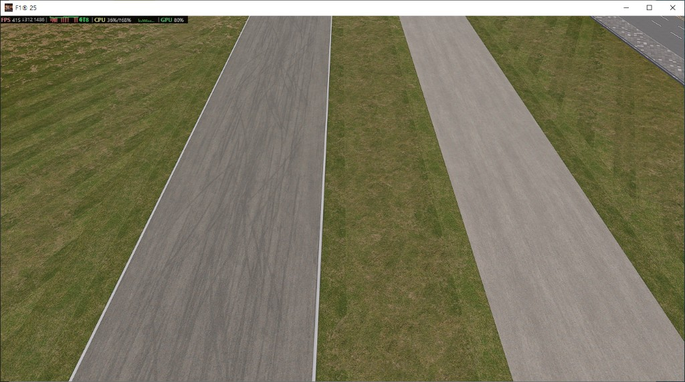
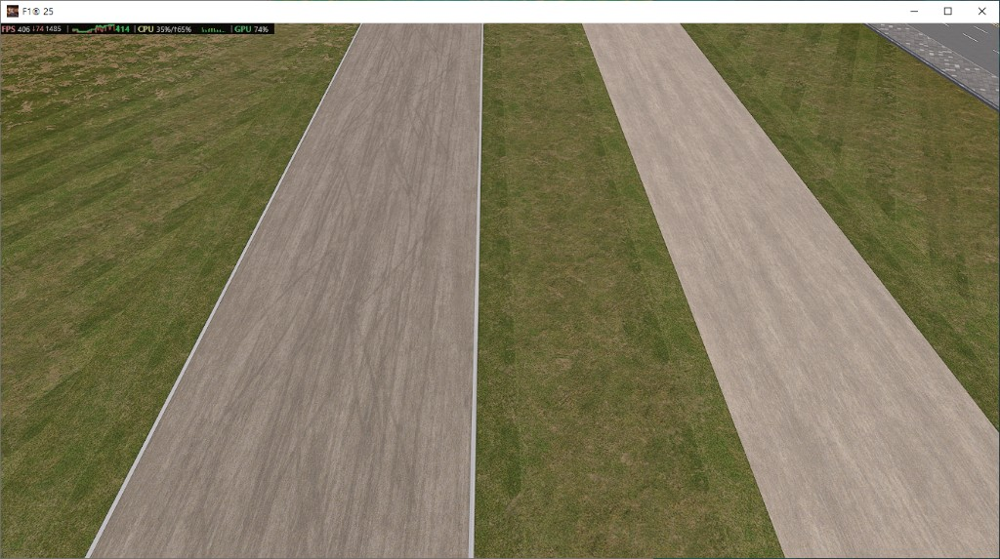

# Track surface and tyre marks

The build dialog can replace the carrier asphalt and the dark tyre-mark strip with a circuit from
`ego-werkzeuge/strecke/daten/fahrbahn.json`. At build time the textures are copied from the F1 25
game folder (lossless, same path as the desert biome). Default is the Portimão carrier (unchanged).

Rebuild the catalog after a game update:

```text
python -m strecke.asphalt_vorlagen analysieren <game folder>
```

Both pictures below are the same straight. The first uses the Abu Dhabi surface and Abu Dhabi tyre
marks, the second the Portimão carrier.




