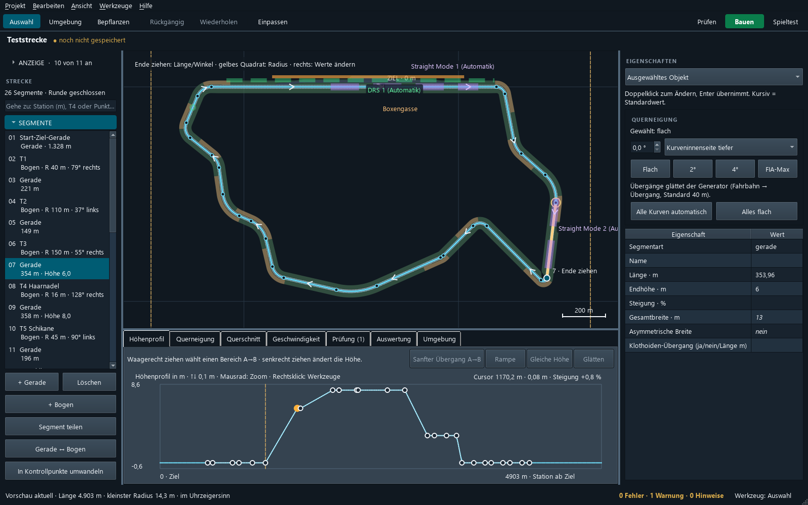

# Mapeditor

Windows desktop editor for designing your own race tracks for **F1 25** and building them into installable track packages.

> Unofficial fan project. Not affiliated with, endorsed by or connected to Electronic Arts, Codemasters, Formula One
> Group or the FIA. "F1" and related names are trademarks of their owners. This project contains no game files.

German version: [README.de.md](README.de.md)



## What it does

- Draw a track from control points or straights and bends, and edit height, banking and width
- Compute the racing line, braking points, corners, sectors, DRS and Straight Mode zones
- Edit the cross-section per range: kerbs, grass, run-off, barriers and the edge angle beside the road
- Place the pit lane, grid and environment objects from the game's own catalogue, add hills and mountains
- Generate ground, racing line and surroundings textures from the track itself
- Check the track against rules learned from the original circuits
- Build a package for the track installer, or swap an installed track directly for testing

The interface is available in German and English.

## Requirements

| | Download | Notes |
|---|---|---|
| System | | Windows 10 or 11, 64-bit |
| Game | [F1 25 on Steam](https://store.steampowered.com/app/3059520/F1_25/) | Read only, needed for the catalogue and for building |
| Installer | [EGO GameDatabases Editor](https://apps.sztefek.eu/app/ego-gamedatabases-editor) | Version 1.6.0 or newer, to install a track and activate it once |
| Carrier package | [Algarve International Circuit (Portimao) for F1 25](https://www.overtake.gg/downloads/algarve-international-circuit-portimao-for-f1-25.87333/) | `portimao.zip`, **not included**. The build uses it as a base, choose it in the build dialog. Do not unpack it |

Drawing and checking a track works without the game. Only building needs the game and the carrier package.

The installer and the Portimão mod are community projects by other authors, please check their pages for terms and updates.
The mod's page warns of game crashes on AMD graphics cards. Tracks built on it may be affected as well.

## Getting started

1. Download `Mapeditor-<version>-win64.zip` from [Releases](../../releases) and unpack the whole folder.
2. Start `Mapeditor.exe`. Windows may warn about an unknown publisher because the program is not signed.
3. Choose **Project → New from template** or open `werkzeugkasten/strecke/beispiele/teststrecke.json`.
4. Press **F1** for the built-in help.

## Known limitations

- **Pit lane on the right only.** With the pit lane on the left of the track, the cars and pit crews stand on the wall side
  until the car leaves. The data matches the original left-side tracks, the cause is unknown. On the right everything works.
- Lighting and garage light maps come from the carrier track.
- Very long tracks work, but exceed the size of any original (gates, visibility cells), so the checks show warnings.
- Time trial and practice are tested most. Other modes are less tested.

## Build from source

Needs [Python 3.10 or newer](https://www.python.org/downloads/).

```powershell
cd Mapeditor
python einrichten.py
.venv\Scripts\python.exe -m pytest tests -q
.venv\Scripts\python.exe packaging\bauen.py
```

The tests skip cases that need files which are not part of this repository, such as the game.

## Safety

The editor never writes to the game folder on its own. Only the explicit quick swap does, and it keeps a backup. Use this
offline, back up your save data and game database first, and use it at your own risk.

## License

Copyright (C) 2026 The Mapeditor authors

This program is free software: you can redistribute it and/or modify it under the terms of the GNU General Public License,
version 3, as published by the Free Software Foundation. It is distributed in the hope that it will be useful, but **without
any warranty**, see [LICENSE](LICENSE). The licence covers this project's code only and grants no rights to the game or its data.

Third-party licences are in `Mapeditor/packaging/lizenzen/`.
